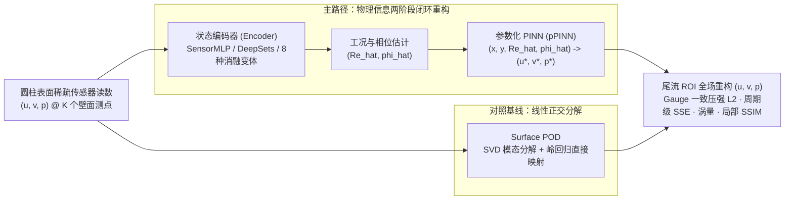

# Cylinder Surface Sensor Flow (`cylinder-flow`)

面向二维圆柱绕流表面稀疏传感器的物理信息深度学习（pPINN）与 POD 流场重构框架。

---

## 1. 项目概览与方法管线（Overview & Pipeline）

本项目研究**仅凭圆柱壁面稀疏传感器瞬时读数 $(u, v, p)$ 反演二维圆柱尾流感兴趣区域（ROI）全场速度与压力场**的问题，构建了从数据接口、物理残差、编码器与流场解码器训练、传感器选位搜索、鲁棒性评估到统计检验与可视化的完整工程化管线。

### 核心方法管线



- **两阶段闭环重构（Encoder → pPINN）**：
  1. **表面状态编码器**：支持固定布局 `SensorMLP`、任意测点数置换不变动态编码器 `DynamicSetSensorEncoder`（DeepSets）以及 8 种结构消融变体（含闭式 `Fourier-K2 Ridge` 基线），从表面观测推断雷诺数 $Re$ 与周期相位 $\phi \in [0, 2\pi)$。
  2. **参数化物理信息网络（pPINN）**：联合拟合流场监督数据与二维不可压缩 Navier-Stokes 动量/连续性 PDE 自动微分残差，根据 $(x, y, Re, \phi)$ 连续重构整个 ROI 区域的速度与压力场。
- **线性基线（Surface POD）**：将表面传感器观测直接通过岭回归映射到 POD 空间模态系数，作为端到端线性重构对照。

### 四大实验工作包（Work Packages）

| 工作包 | CLI 子命令 | 研究主题与核心产出 |
| :--- | :--- | :--- |
| **WP-A** | `wp-a` | **传感器选位策略对比与统一评估**：在固定已选 pPINN 的 Scheme-A 协议下，系统对比 `uniform`、`physics`、`random`、`greedy`（D-optimal）、`qr_pod`、`linreg_greedy`、`pod_greedy` 与 `amortized_chain_greedy` 等选位策略，计算传感器超额误差与配对统计显著性 |
| **WP-B** | `wp-b` | **动态编码器与结构消融**：对比共享动态 DeepSets 与各布局专训 MLP 在未见组合与未见测点预算下的泛化能力、缺失退化曲线，以及 8 种编码器架构消融对比 |
| **WP-C** | `wp-c` | **噪声与缺失传感器鲁棒性**：基于训练集候选池通道标准差注入可控高斯噪声 $x'_c = x_c + \sigma_{\mathrm{rel}} s_c Z_c$ 并结合测点缺失掩码，跨模型家族评估退化与排序稳定性 |
| **WP-D** | `wp-d` | **全场重构与物理空间指标分析**：综合评估 Oracle pPINN、闭环重构与 POD 基线在全流场、尾流区与壁面探针上的 Gauge 压强误差、非结构网格无量纲涡量相对 $L_2$、局部 SSIM、物理残差及 $\lambda_{\text{phys}}$ Pareto 权衡 |

### 核心规范

- **严格工况隔离**：训练、验证（如 $Re \in \{450, 800\}$）与测试（锁定 $Re \in \{250, 650\}$）工况严格互斥；模型选型、归一化拟合、噪声尺度估计与布局搜索期间严禁读取测试集，评测测试集须显式提供 `--allow-test` 及已批准的分析锁清单。
- **压力 Gauge 一致性**：不可压缩流场压力存在任意常数不确定度，所有主压力误差均采用基于 Welford/Chan 算法的**同分母 Gauge 一致相对 $L_2$**（`p_rel_l2_gauge_sameden`），未对齐原始值仅隔离保留在 `*_raw` 字段。
- **Strouhal 关系保护**：通过 `compute_st_from_re` 计算涡脱落斯特劳哈尔数 $St$，输出超出物理有效区间 $[0.01, 1.0]$ 时触发告警。
- **配对随机种子**：不同选位策略与模型对比复用一致的配对训练种子，并记录布局 SHA-256 指纹与 `run_meta.json`。
- **完整涡脱落周期对齐**：按相位 $[0, 2\pi)$ 环绕识别完整周期，在周期层级累积原始残差平方和（SSE），而非直接平均单快照相对误差。

---

## 2. 仓库结构与文件职责（Repository Structure）

### 顶层目录概览

```text
cylinder_surface_sensor_flow/
├── README.md                       # 项目总览、配置与使用指南（本文件）
├── AGENTS.md                       # 科研红线与开发协作约束
├── pyproject.toml                  # 标准包定义、依赖与命令行入口 (cylinder-flow)
├── environment.yml                 # Conda 环境定义
├── requirements.txt                # 可编辑安装指向 (-e .)
├── src/cylinder_flow/              # 核心 Python 主包
├── configs/                        # 路径模板、工况划分与各工作包协议模板
├── examples/                       # 随仓附带的轻量预训练权重、网格与示例结果 (~6.3 MiB)
├── scripts/                        # Windows PowerShell 封装与批处理目录
├── tests/                          # 契约测试、数值回归测试与端到端冒烟测试
└── docs/                           # 架构说明、HDF5 数据契约与指标数学文档
```

### 核心主包逐文件职责（`src/cylinder_flow/`）

| 层级 / 子包 | 文件路径 | 核心职责 |
| :--- | :--- | :--- |
| **顶层入口与配置** | `__init__.py` | 顶层包导出与版本声明 |
| | `__main__.py` | 支持 `python -m cylinder_flow` 与 `cylinder-flow` 入口启动 |
| | `cli.py` | 统一命令行解析器与 8 个子命令分发（`wp-a`/`wp-b`/`wp-c`/`wp-d`/`train-encoder`/`train-ppinn`/`eval`/`preprocess`） |
| | `config.py` | 四级优先级路径配置解析（`PathConfig`、`get_path_config()`） |
| **数据层 (`data/`)** | `types.py` | `MeshData`（ROI 网格与候选测点几何）与 `ReCaseData`（单工况传感器、相位、周期掩码与可选全场数据）数据结构 |
| | `h5.py` | 统一 HDF5 读写（`load_mesh`、`load_re_case`、`load_re_cases`、`discover_available_re_ids`），支持按需延迟加载全场并前置测试集防护 |
| | `splits.py` | `ReSplit` 工况划分、严格不相交校验（`check_re_split_disjoint`）、`folds.json` 读取与测试集锁定门禁 |
| | `normalization.py` | 仅训练集拟合的特征/雷诺数归一化器 `Normalizer`（`standard`/`minmax`/`none`）及通道统计提取 |
| | `sampling.py` | 固定布局 `SensorDataset`、动态多预算平衡采样 `BalancedRandomSubsetSampler`、`DynamicBatchCollator`（含 token dropout 与噪声增强） |
| | `preprocessing.py` | 外部 CFD-to-HDF5 预处理占位说明（本包直接读取符合 `docs/data_format.md` 的 HDF5 文件） |
| **物理层 (`physics/`)** | `scaling.py` | 经验频率/Strouhal 公式 `compute_st_from_re`、压力尺度（`rho_uinf2`/`uinf2`/`none`）及无量纲双向变换 |
| | `residuals.py` | 二维不可压缩 Navier-Stokes 动量与连续性方程自动微分残差（`compute_pde_residuals`、`navier_stokes_residuals`） |
| | `collocation.py` | 计算域配点采样（`uniform_random`/`latin_hypercube`/`sobol`、圆柱内部剔除）与 `ReSTContext` |
| **模型层 (`models/`)** | `activations.py` | 共享激活函数映射（ReLU / GELU / Tanh 等） |
| | `mlp.py` | 固定布局表面传感器编码器 `SensorMLP` |
| | `deepsets.py` | 置换不变固定/动态集合编码器 `SetSensorEncoder`、`DynamicSetSensorEncoder` 与动态契约指纹校验 |
| | `ablations.py` | 8 种架构消融变体（7 种神经网络含 slot-scatter 变体 + 闭式 `FourierRidgeRegressor` 与 `StreamingRidgeAccumulator`） |
| | `ppinn.py` | 参数化流场物理信息网络 `PPINNModel`（别名 `ParametricPINN`） |
| | `pod.py` | `SurfacePOD`（别名 `PODModel`）SVD 模态分解与无截距惩罚岭回归基线 |
| **训练层 (`training/`)** | `encoder.py` | `MLPTrainer`、`DeepSetsTrainer`、`train_sensor_mlp`、`train_sensor_deepsets`（同时支持消融神经网络与闭式 Ridge 拟合） |
| | `dynamic_validation.py` | 冻结 60 候选验证面板（32 布局 × 4 预算）构建与等权重分层验证聚合 |
| | `ppinn.py` | `PPINNTrainer`、`train_ppinn` 数据+PDE 物理协同训练与配点重采样控制 |
| | `pod.py` | `PODTrainingConfig` 与 `train_surface_pod` 拟合流程与元数据审计 |
| **推理层 (`inference/`)** | `encoder.py` | 统一编码器推理（`predict_re_phase`、`predict_re_phase_full`、`predict_re_case`），支持 `DynamicSensorBatch` 与展平输入 |
| | `reconstruction.py` | 分块防 OOM 流场重构（`reconstruct_field_chunked`、Oracle 与闭环重构接口） |
| **选位层 (`layouts/`)** | `basic.py` | 基础策略（`uniform`、`physics`、`random`）、`LayoutStrategy` 协议与防泄漏 `SensorSplitData` |
| | `baselines.py` | 基线选位算法：`qr_pod`（QR-QDEIM + D-optimal）、`linreg_greedy`、`pod_greedy` |
| | `scoring.py` | 验证集 FIM 格拉姆矩阵、pPINN 敏感度二次型、稀疏验证协议、闭环超额误差评分与 `n=1` 选择偏差告警 |
| | `greedy.py` | 前向贪心主循环（D-optimal、链式贪心、摊销链式贪心）及锁定布局配对种子重训 |
| **评测层 (`evaluation/`)** | `cycles.py` | 圆周相位环绕/角差、涡脱落周期切分 `detect_cycles_from_phase` 及周期级原始 SSE 累积 |
| | `field.py` | `PressureGaugeAccum`（Welford/Chan 同分母 Gauge 压强 $L_2$）、`FieldMetricsAccum` 与 `compute_field_metrics` |
| | `regression.py` | 雷诺数回归误差（MAE/RMSE）与圆周相位误差（cMAE/cRMSE） |
| | `spatial.py` | 非结构 kNN 最小二乘导数算子 `UnstructuredDerivativeOperator`（无量纲涡量 $\omega^*$）、流体/尾流掩码与局部 SSIM |
| | `robustness.py` | 训练集噪声尺度构建/校验、规范全候选池标准正态噪声注入、缺失传感器掩码与有效测点计数 |
| | `runner.py` | 统一评测调度器（`evaluate_ppinn_oracle`、`evaluate_closed_loop_pipeline`、`evaluate_pod_baseline`、`evaluate_cases_to_long_rows`） |
| **分析层 (`analysis/`)** | `aggregate.py` | 多工作包长表汇聚、粒度去重（`overall`/`per_re`/`per_cycle`）与 `AuditLog` 严格模式审计 |
| | `statistics.py` | 配对分层块 Bootstrap、Cohen's $d_z$、rank-biserial、精确双侧 Wilcoxon（$\ge 10$ 非零差值与并列门禁）与 Holm-Bonferroni 校正 |
| | `plotting.py` | 无头（`Agg`）传感器圆周布局图及 WP-B/C/D 曲线、对比图与绘图 CSV 数据表导出 |
| **工件层 (`artifacts/`)** | `checkpoints.py` | MLP、DeepSets（Schema v1/v2）、消融变体、pPINN 与 POD 权重读写及跨平台路径反序列化兼容 |
| | `tracking.py` | `run_meta.json` 溯源生成、布局 SHA-256 指纹与确定性配对种子派生 |
| | `results.py` | 23 字段公共长表 `LONG_TABLE_FIELDS` 规范、方向判定及扩展列 CSV 读写 |
| | `manifests.py` | 协议/清单/分析锁加载、SHA-256 校验、占位路径拦截与测试集锁定门禁 |
| **工作流层 (`workflows/`)** | `wp_a.py` | WP-A 编排（Scheme-A pPINN 验证集选模、布局搜索/统一评估、汇聚、统计与出图） |
| | `wp_b.py` | WP-B 编排（布局留出生成、动态 vs 专训评估、8 种结构消融分发与结果分析） |
| | `wp_c.py` | WP-C 编排（噪声尺度计算、可断点续跑鲁棒性矩阵评估 `WPCProgressStore` 与描述性分析） |
| | `wp_d.py` | WP-D 编排（Oracle/闭环/POD 全场重构、空间与物理指标、统计出图与 Markdown/JSON 报告生成） |

### 配置、脚本、测试与文档目录

| 目录 / 文件 | 用途说明 |
| :--- | :--- |
| `configs/paths.example.json` | 本地路径覆盖模板；复制为 `configs/paths.json`（已被 `.gitignore` 忽略）即可指向本机数据目录 |
| `configs/folds.json` | 雷诺数折划分定义（`default`、`loo_450`、`loo_800`） |
| `configs/examples/quickstart.json` | 指向 `examples/` 内置资产的最小配置示例 |
| `configs/experiments/wp_{a,b,c,d}/*.example.json` | 四大工作包的协议、配对比较、布局留出与分析锁 JSON 模板（纯相对路径） |
| `scripts/windows/run_wp_{a,b,c,d}.ps1` | Windows PowerShell 薄封装脚本，直接透传参数给 `python -m cylinder_flow wp-*` |
| `tests/contracts/`、`tests/regression/`、`tests/smoke/` | 数据/契约测试、数值一致性与防泄漏回归测试、训练/工作流/CLI 端到端冒烟测试 |
| `docs/architecture.md`、`docs/data_format.md`、`docs/metrics.md` | 架构依赖图、HDF5 字段与坐标规范、误差指标与统计口径详细参考文档 |

### 内置轻量复现资产（`examples/`，合计约 6.3 MiB）

| 类别 | 仓库路径 | 体积 | 说明 |
| :--- | :--- | :--- | :--- |
| **固定布局 MLP** | `examples/checkpoints/mlp/best_model.pt` | ~0.14 MiB | 6 测点均匀布局 `[0, 10, 20, 30, 40, 50]`，含 `checkpoint_meta.json` |
| **动态 DeepSets** | `examples/checkpoints/deepsets/best_model.pt` | ~0.34 MiB | 任意测点数置换不变编码器（Schema v1 GELU），含 `config.json` |
| **pPINN 流场模型** | `examples/checkpoints/ppinn/best_ppinn.pt` | ~0.32 MiB | 参数化流场重构权重（$D=0.01$、$\rho=1000$），含 `config.json` |
| **Surface POD 基线** | `examples/checkpoints/pod/pod_model.npz` | ~4.62 MiB | 60 候选测点线性 POD 基线，含 `eval_config.json` 与 `pod_model_info.json` |
| **圆柱 ROI 网格** | `examples/data/mesh.h5` | ~0.75 MiB | 二维圆柱边界与 60 候选测点坐标 |
| **示例结果表** | `examples/results/wp_a_sample_metrics_long.csv`<br/>`examples/results/wp_a_sample_layouts.json`<br/>`examples/results/wp_d_sample_results_long.csv` | ~36 KiB | 仅含验证工况（$Re \in \{450, 800\}$）的轻量示例表，用于零外部数据体验统计与出图 |

所有内置资产的 SHA-256 校验和与字节数均登记在 [`examples/artifacts.json`](examples/artifacts.json) 中。完整非定常工况数据（`ReXXX.h5`）因体积较大外置存放，字段格式详见 [`docs/data_format.md`](docs/data_format.md)。

### 核心架构代码阅读指引（跳过工程外框，直达神经网络）

若仅想快速理解本项目的神经网络设计与物理闭环原理，**可直接跳过** `data/`、`layouts/`、`evaluation/`、`analysis/`、`artifacts/` 与 `workflows/`，按以下 3 步直达核心类（其余长文件中的校验/序列化样板代码可忽略）：

| 步序 | 文件与核心类（含行号） | 重点关注内容 | 可跳过的冗余部分 |
| :--- | :--- | :--- | :--- |
| **1. 固定布局编码器** | [`mlp.py`](src/cylinder_flow/models/mlp.py#L14-L108) — `SensorMLP` | `[B, 3K]` 展平传感器输入 $\to [Re_{\text{norm}}, \sin\phi, \cos\phi]$ 回归（`__init__`、`forward`） | 无（可直接通读） |
| **2. 置换不变编码器 (DeepSets)** | [`deepsets.py`](src/cylinder_flow/models/deepsets.py#L69-L170) — `SetSensorEncoder`（固定点数）<br/>[`deepsets.py`](src/cylinder_flow/models/deepsets.py#L726-L800) — `DynamicSensorBatch`<br/>[`deepsets.py`](src/cylinder_flow/models/deepsets.py#L894-L1057) — `DynamicSetSensorEncoder`（动态点数）<br/>[`deepsets.py`](src/cylinder_flow/models/deepsets.py#L1060-L1100) — `FixedFlattenedAdapter` | `(cos θ, sin θ)` 位置编码、padding `mask`、集合池化（`mean`/`sum`/`max`/`mean+max`）与测点比例特征 `n/N_cand`（重点看 `forward_tokens` `L988–L1032`） | `L173–L722`（索引/契约指纹校验）与 `L1107–L1175`（几何读取） |
| **3. pPINN、PDE 残差与闭环串联** | [`ppinn.py`](src/cylinder_flow/models/ppinn.py#L16-L140) — `PPINNModel`<br/>[`residuals.py`](src/cylinder_flow/physics/residuals.py#L89-L187) — `compute_pde_residuals`<br/>[`reconstruction.py`](src/cylinder_flow/inference/reconstruction.py#L172-L245) — `reconstruct_field_closed_loop` | `PPINNModel.forward` 内部 `(x/D, y/D, Re_norm, sin φ, cos φ)` 映射；二阶自动微分 NS 动量/连续性残差；编码器与 pPINN 的两阶段闭环前向串联 | `training/` 训练外框、`reconstruct_case_*` 包装 |

---

## 3. 环境配置指引（Environment Setup）

### 前置要求
- **操作系统**：Linux 或 Windows
- **Python**：`>= 3.10`
- **硬件**：推荐支持 CUDA 的 GPU（仅推理与轻量测试在 CPU 上亦可运行）

### 1）克隆仓库

```bash
git clone https://github.com/leecf886/Cylinder_surface_sensor_flow.git
cd Cylinder_surface_sensor_flow
```

### 2）创建环境并安装依赖

#### 方式 A：使用 Conda `environment.yml`（推荐）

```bash
conda env create -f environment.yml
conda activate surface_cylinder_flow
pip install -e ".[analysis,dev]"
```

#### 方式 B：手动 Conda 安装

```bash
conda create -n surface_cylinder_flow python=3.10 -y
conda activate surface_cylinder_flow

# 安装 PyTorch（按本机 CUDA 版本选择，如 CUDA 12.4；CPU 版直接 pip install torch）
pip install torch --index-url https://download.pytorch.org/whl/cu124

# 可编辑安装主包及绘图/测试可选依赖
pip install -e ".[analysis,dev]"
```

#### 方式 C：使用标准 Python 虚拟环境 (`venv`)

```bash
python -m venv .venv

# 激活环境
# Windows PowerShell:
.venv\Scripts\Activate.ps1
# Linux / macOS:
source .venv/bin/activate

pip install torch --index-url https://download.pytorch.org/whl/cu124
pip install -e ".[analysis,dev]"
```

### 3）验证安装

```bash
# 查看统一命令行帮助（也可用 cylinder-flow --help）
python -m cylinder_flow --help

# 运行一条无需外部数据的端到端冒烟测试
pytest -q tests/smoke/test_results_analysis.py
```

---

## 4. 30 秒零外部数据快速体验（Quickstart）

无需下载外部 `ReXXX.h5`，直接使用仓库内置的 `examples/` 权重、网格与示例结果即可完成以下三项体验：

### 1）体验统一 CLI 预检（`preflight --dry-run`）

```bash
python -m cylinder_flow wp-a --config configs/experiments/wp_a/protocol.example.json --stages preflight --dry-run
python -m cylinder_flow wp-b --config configs/experiments/wp_b/protocol.example.json --stages preflight --mode dynamic --dry-run
python -m cylinder_flow wp-c --config configs/experiments/wp_c/protocol.example.json --stages preflight --dry-run
python -m cylinder_flow wp-d --config configs/experiments/wp_d/protocol.example.json --stages preflight --dry-run
```

### 2）加载内置权重跑一次闭环前向推理（DeepSets + pPINN）

```python
import numpy as np
from cylinder_flow.artifacts import load_deepsets_checkpoint, load_legacy_ppinn_checkpoint
from cylinder_flow.data import load_mesh
from cylinder_flow.inference import DynamicSensorBatch, reconstruct_field_closed_loop

mesh = load_mesh("examples/data/mesh.h5")
encoder_pkg = load_deepsets_checkpoint("examples/checkpoints/deepsets/best_model.pt")
ppinn_pkg = load_legacy_ppinn_checkpoint("examples/checkpoints/ppinn/best_ppinn.pt")

# 选取 6 个壁面测点构造 2 帧合成传感器观测，仅在 ROI 前 64 个网格点上快速重构
sensor_idx = [0, 10, 20, 30, 40, 50]
rng = np.random.default_rng(42)
values = rng.normal(scale=0.1, size=(2, len(sensor_idx), 3)).astype(np.float32)
pos = np.broadcast_to(encoder_pkg.candidate_positions[sensor_idx][None, :, :], (2, len(sensor_idx), 2)).astype(np.float32).copy()
mask = np.ones((2, len(sensor_idx)), dtype=bool)
count = np.full((2, 1), float(len(sensor_idx)), dtype=np.float32)

batch = DynamicSensorBatch(values=values, pos=pos, mask=mask, count=count)
field_pred, enc_pred = reconstruct_field_closed_loop(
    mlp=encoder_pkg,
    ppinn=ppinn_pkg,
    mesh_xy=mesh.roi_xy[:64],
    sensor_inputs=batch,
)
print("Predicted Re:", enc_pred.re, "Phase (rad):", enc_pred.phase, "Field shape:", field_pred.shape)
```

### 3）基于内置示例结果跑一次配对统计与无头出图

```python
import json, math, tempfile
from pathlib import Path
import numpy as np
from cylinder_flow.analysis import (
    load_results_long,
    plot_sensor_layouts,
    plot_wp_d_results,
    run_comparison,
)

# 1. 配对分层 Bootstrap + 精确 Wilcoxon 显著性检验（10 个配对种子，val Re 450/800）
wp_a_rows = load_results_long("examples/results/wp_a_sample_metrics_long.csv")
stat = run_comparison(
    wp_a_rows,
    {
        "comparison_id": "sample_amortized_vs_uniform",
        "strategy_a": "amortized_chain_greedy",
        "strategy_b": "uniform",
        "evaluator": "ppinn_closed_loop",
        "metric": "overall_rel_l2_gauge_sameden",
        "granularity": "per_cycle",
        "nsensor": 12,
        "split": "val",
        "paired_unit": "seed",
        "confirmatory": True,
        "holm_family": "demo",
    },
    n_bootstrap=200,
)
print("mean_improvement:", stat.mean_improvement, "wilcoxon_p:", stat.wilcoxon_p_raw, "status:", stat.wilcoxon_p_status)

# 2. 无头导出布局与流场重构汇总表/图（去掉 no_png=True 即可同时输出 PNG）
layouts = json.loads(Path("examples/results/wp_a_sample_layouts.json").read_text(encoding="utf-8"))["layouts"]
wp_d_rows = load_results_long("examples/results/wp_d_sample_results_long.csv")
theta = np.linspace(0.0, 2.0 * math.pi, 60, endpoint=False)

with tempfile.TemporaryDirectory() as out_dir:
    plot_sensor_layouts(layouts, theta=theta, output_dir=Path(out_dir) / "layouts", no_png=True)
    plot_wp_d_results(wp_d_rows, [], Path(out_dir) / "wp_d", no_png=True)
```

---

## 5. 路径配置、超参数体系与启动命令指引

本项目的路径、工况划分与训练/实验超参数均已模块化，**严禁在源码中硬编码本机路径**。

### 5.1 模块化路径配置（四级解析优先级）

所有 CLI 命令与工作流统一通过 `cylinder_flow.config.get_path_config()` 解析路径，优先级由高到低为：

```text
1. CLI 命令行参数 (--data-dir / --processed-dir / --runs-dir)
   > 2. 环境变量 (CYLINDER_DATA_ROOT)
      > 3. 本地配置文件 (configs/paths.json，已被 .gitignore 忽略)
         > 4. 默认相对路径 (./data, ./data/processed_data_base_60, ./runs)
```

**推荐配置步骤**：

1. 复制模板文件：
   ```bash
   cp configs/paths.example.json configs/paths.json
   ```
2. 按本机数据目录编辑 `configs/paths.json`：
   ```json
   {
     "data_root": "/path/to/cylinder_flow_data",
     "processed_dir": "/path/to/cylinder_flow_data/processed_data_base_60",
     "runs_dir": "/path/to/cylinder_flow_data/runs",
     "checkpoints": {
       "mlp": "/path/to/cylinder_flow_data/runs/mlp_runs",
       "pinn": "/path/to/cylinder_flow_data/runs/pinn_runs",
       "pod": "/path/to/cylinder_flow_data/runs/pod_runs"
     }
   }
   ```
3. 或通过环境变量 / CLI 临时覆盖：
   ```bash
   # Linux/macOS:
   export CYLINDER_DATA_ROOT=/path/to/cylinder_flow_data
   # Windows PowerShell:
   $env:CYLINDER_DATA_ROOT = "/path/to/cylinder_flow_data"

   # 单次命令临时覆盖（优先级最高）：
   python -m cylinder_flow --data-dir /path/to/data --processed-dir /path/to/processed --runs-dir ./runs wp-a --stages preflight
   ```

> **数据目录组织要求**：`processed_dir` 下需放置 `mesh.h5` 及对应雷诺数文件 `Re200.h5`, `Re225.h5`, …, `Re1000.h5`。原始 CFD（Fluent）到 HDF5 的转换外置完成，具体字段约定见 [`docs/data_format.md`](docs/data_format.md)。运行 `python -m cylinder_flow preprocess` 可查看输入格式契约提示。

---

### 5.2 模块化超参数与协议配置指引

项目将超参数与实验设置拆分为三层，按需修改对应文件或参数类即可：

#### （1）雷诺数工况划分：`configs/folds.json`
集中管理全部实验折的 `train_re` / `val_re` / `test_re`：
- `default`：训练 14 个工况（200–1000），验证 `[450, 800]`，锁定测试 `[250, 650]`；
- `loo_450` / `loo_800`：留一验证折，测试集仍锁定为 `[250, 650]`。

#### （2）工作包实验协议模板：`configs/experiments/wp_{a,b,c,d}/*.example.json`
复制对应的 `.example.json` 修改后通过 `--config <your_protocol.json>` 传入即可：

| 配置文件 | 主要可调配置块与核心参数 |
| :--- | :--- |
| `configs/examples/quickstart.json` | 最小路径覆盖、`fold`、`physics`（`cylinder_diameter`、`fluid_density`、`pressure_scale_mode`） |
| `configs/experiments/wp_a/protocol.example.json` | `fold`、`ppinn_policy`（Scheme-A 固定选模）、`ppinn_selection`（候选权重与选模指标）、`layout_protocol`（策略列表、测点预算、配对种子）、`statistical_protocol`（Bootstrap 次数、Holm 家族） |
| `configs/experiments/wp_b/protocol.example.json` & `arch_ablation_protocol.example.json` | `mode`（`dynamic` / `arch_ablation`）、`training`（`num_epochs`、`batch_size`、`training_sensor_counts`、`train_specialized`）、`exact_k_dropout`（缺失种子与预算）、`dynamic_variants`、`seeds` |
| `configs/experiments/wp_c/protocol.example.json` | `noise_protocol`（相对噪声等级、噪声种子、训练集通道尺度）、`evaluation_matrix`（策略/预算/模型家族）、`artifact_bindings`、`formal_execution_gates` |
| `configs/experiments/wp_d/protocol.example.json` | `metric_contract`（Gauge 压强、涡量导数算子与 SSIM 冻结尺度）、`d1_reconstruction_matrix`、`d2_physics_regularization_matrix`（$\lambda_{\text{phys}}$ 扫描）、`statistical_protocol` |
| `*/comparisons.example.json` & `*/analysis_lock.example.json` | 预注册配对比较清单与测试集解封分析锁模板（正式开启测试集评估前需填充真实绑定并审批） |

#### （3）Python 代码级超参数配置类（`dataclass`）

| 配置类 | 所在模块 | 核心超参数 |
| :--- | :--- | :--- |
| `EncoderTrainingConfig` | `cylinder_flow.training` | `num_epochs`, `batch_size`, `learning_rate`, `weight_decay`, `lambda_re`, `lambda_phase`, `hidden_dims`, `seed`, `device` |
| `DeepSetsTrainingConfig` | `cylinder_flow.training` | 在上述基础上增加 `schema_version`（新训练默认 `2` / ReLU）、`training_sensor_counts=(6,12,24,48)`、`token_dropout_prob`、`sensor_noise_rel_std`、`validation_mode`（`frozen_panel`）、`dataloader_shuffle_seed` |
| `PPINNTrainingConfig` | `cylinder_flow.training` | `train_re`, `val_re`, `test_re`, `batch_size`, `n_collocation`, `collocation_sampling_method`, `num_epochs`, `learning_rate`, `lambda_data`, `lambda_phys`, `pressure_scale_mode="rho_uinf2"`, `checkpoint_selection_metric`, `seed` |
| `PODTrainingConfig` | `cylinder_flow.training` | `ridge_lambda`, `energy_ratio`, `min_modes`, `max_modes`, `n_modes`, `x_norm_method`, `seed` |
| `WPAConfig` / `WPBConfig` / `WPCConfig` / `WPDConfig` | `cylinder_flow.workflows` | 分别对应各工作包 JSON 协议的反序列化对象，由 `load_wp_{a,b,c,d}_config(...)` 加载并合并路径覆盖 |

> **检查点 Schema 兼容说明**：
> - **内置 DeepSets 权重**（`examples/checkpoints/deepsets/best_model.pt`）使用 **Schema v1（GELU）**，`load_deepsets_checkpoint` 自动识别并校验，无需手动改配置。
> - **新训练 DeepSets 模型**默认使用 **Schema v2（ReLU）**。
> - **8 种结构消融变体**使用独立契约 `dynamic_arch_ablation_schema_v1`，通过 `load_ablation_checkpoint` / `save_ablation_checkpoint` 读写。

---

### 5.3 单阶段训练、推理与评测启动命令

#### 1）统一 CLI 启动命令

```bash
# 训练固定布局 MLP 编码器（--dry-run 仅打印解析后的配置与路径，去掉后开始真实训练）
python -m cylinder_flow train-encoder \
  --encoder mlp \
  --fold default \
  --sensor-indices 0,10,20,30,40,50 \
  --epochs 100 --batch-size 512 --lr 1e-3 --seed 42 --device cuda \
  --output-dir runs/mlp_uniform6

# 训练动态 DeepSets 编码器
python -m cylinder_flow train-encoder \
  --encoder deepsets \
  --fold default \
  --epochs 200 --batch-size 512 --lr 1e-3 --seed 42 --device cuda \
  --output-dir runs/deepsets_dynamic

# 训练参数化 pPINN
python -m cylinder_flow train-ppinn \
  --fold default \
  --epochs 200 --batch-size 2048 --lr 1e-3 --lambda-phys 1.0 --seed 42 --device cuda \
  --output-dir runs/ppinn_default

# 验证集评估：Oracle pPINN / 闭环 (Encoder + pPINN) / POD 基线
# （默认按完整涡脱落周期累积计算 per-Re 与 overall 指标）
python -m cylinder_flow eval \
  --mode oracle \
  --ppinn-ckpt examples/checkpoints/ppinn/best_ppinn.pt \
  --re-list 450,800 --device cuda --output-dir runs/eval_oracle

python -m cylinder_flow eval \
  --mode closed_loop \
  --ppinn-ckpt examples/checkpoints/ppinn/best_ppinn.pt \
  --encoder-ckpt examples/checkpoints/deepsets/best_model.pt \
  --re-list 450,800 --device cuda --output-dir runs/eval_closed_loop

python -m cylinder_flow eval \
  --mode pod \
  --pod-ckpt examples/checkpoints/pod/pod_model.npz \
  --re-list 450,800 --output-dir runs/eval_pod

# 评测锁定测试集 (Re=250, 650) 必须同时传入 --allow-test 与已批准的 --analysis-lock
python -m cylinder_flow eval \
  --mode closed_loop \
  --ppinn-ckpt examples/checkpoints/ppinn/best_ppinn.pt \
  --encoder-ckpt examples/checkpoints/deepsets/best_model.pt \
  --re-list 250,650 \
  --allow-test --analysis-lock /path/to/approved_analysis_lock.json \
  --output-dir runs/eval_test

# 查看 HDF5 预处理输入契约说明
python -m cylinder_flow preprocess
```

> 以上所有命令均可附加 `--dry-run` 先验证路径、工况划分与超参数解析而不触发实际计算。

#### 2）常用 Python 训练 API 示例

```python
from cylinder_flow.training import (
    DeepSetsTrainingConfig,
    EncoderTrainingConfig,
    PPINNTrainingConfig,
    train_ppinn,
    train_sensor_deepsets,
    train_sensor_mlp,
)

# 1. 固定布局 MLP 训练
mlp_cfg = EncoderTrainingConfig(num_epochs=100, batch_size=512, learning_rate=1e-3, seed=42)
mlp_model, mlp_hist = train_sensor_mlp(
    train_loader=train_loader,
    val_loader=val_loader,
    config=mlp_cfg,
    sensor_indices=[0, 10, 20, 30, 40, 50],
    output_dir="runs/mlp_uniform6",
)

# 2. 动态 DeepSets 训练（正式模式自动启用冻结 60 候选验证面板选模）
ds_cfg = DeepSetsTrainingConfig(
    num_epochs=200,
    batch_size=512,
    learning_rate=1e-3,
    seed=42,
    schema_version=2,
    training_sensor_counts=(6, 12, 24, 48),
    token_dropout_prob=0.05,
    sensor_noise_rel_std=0.01,
)
ds_model, ds_hist = train_sensor_deepsets(
    train_loader=dynamic_train_loader,
    val_loader=val_dataset,
    config=ds_cfg,
    output_dir="runs/deepsets_dynamic",
)

# 3. 参数化 pPINN 物理+数据协同训练
ppinn_cfg = PPINNTrainingConfig(
    train_re=[200, 225, 275, 300, 350, 400, 500, 550, 600, 700, 750, 850, 900, 1000],
    val_re=[450, 800],
    test_re=[250, 650],
    batch_size=2048,
    n_collocation=4096,
    num_epochs=200,
    lambda_data=1.0,
    lambda_phys=1.0,
    pressure_scale_mode="rho_uinf2",
    seed=42,
)
ppinn_model, ppinn_hist = train_ppinn(
    train_cases=train_cases,
    val_cases=val_cases,
    mesh=mesh,
    config=ppinn_cfg,
    output_dir="runs/ppinn_default",
)
```

---

### 5.4 四大工作包实验启动命令（WP-A / WP-B / WP-C / WP-D）

所有工作包**默认阶段均为 `preflight`**（只做协议与依赖检查，不会误触发训练或打开测试集），通过 `--stages` 按逗号指定要执行的阶段组合。

| 工作包 | 支持的 `--stages` 列表 | 关键附加开关 |
| :--- | :--- | :--- |
| **WP-A** | `preflight`, `ppinn_select`, `shared_encoder`, `layout_search`, `unify`, `aggregate`, `stats`, `plot` | `--dry-run`, `--allow-test`, `--overwrite`, `--no-png`, `--strict-aggregate` |
| **WP-B** | `preflight`, `layout_holdout`, `train`, `evaluate`, `ablation_evaluate`, `aggregate`, `stats`, `plot` | `--mode dynamic\|arch_ablation`, `--dry-run`, `--allow-test`, `--formal` |
| **WP-C** | `preflight`, `noise_scale`, `evaluate`, `aggregate`, `stats`, `plot` | `--dry-run`, `--resume`（断点续跑）, `--allow-test`, `--no-png` |
| **WP-D** | `preflight`, `evaluate`, `aggregate`, `stats`, `plot`, `report` | `--dry-run`, `--allow-test`, `--formal`, `--no-png` |

#### 跨平台 CLI 启动示例

```bash
# WP-A：传感器选位与统一评估（示例：预检 -> 验证集选模 -> 汇总统计与出图）
python -m cylinder_flow wp-a \
  --config configs/experiments/wp_a/protocol.example.json \
  --stages preflight,ppinn_select,unify,aggregate,stats,plot \
  --output-dir runs/wp_a

# WP-B：动态编码器（dynamic）与 8 种结构消融（arch_ablation）
python -m cylinder_flow wp-b \
  --config configs/experiments/wp_b/protocol.example.json \
  --mode dynamic \
  --stages preflight,layout_holdout,evaluate,aggregate,stats,plot \
  --output-dir runs/wp_b

python -m cylinder_flow wp-b \
  --config configs/experiments/wp_b/arch_ablation_protocol.example.json \
  --mode arch_ablation \
  --stages preflight,ablation_evaluate,aggregate,stats,plot \
  --output-dir runs/wp_b_ablation

# WP-C：噪声与缺失传感器鲁棒性（支持 --resume 断点续跑）
python -m cylinder_flow wp-c \
  --config configs/experiments/wp_c/protocol.example.json \
  --stages preflight,noise_scale,evaluate,aggregate,stats,plot \
  --resume \
  --output-dir runs/wp_c

# WP-D：全场重构、空间/物理指标与 Markdown/JSON 报告生成
python -m cylinder_flow wp-d \
  --config configs/experiments/wp_d/protocol.example.json \
  --stages preflight,evaluate,aggregate,stats,plot,report \
  --output-dir runs/wp_d
```

#### Windows PowerShell 封装脚本启动示例

`scripts/windows/` 下的薄封装脚本支持通过 `-PythonExe` 指定解释器路径（默认为 `python`）：

```powershell
.\scripts\windows\run_wp_a.ps1 -Config configs\experiments\wp_a\protocol.example.json -Stages preflight -DryRun
.\scripts\windows\run_wp_b.ps1 -ConfigPath configs\experiments\wp_b\protocol.example.json -Stages preflight -Mode dynamic -DryRun
.\scripts\windows\run_wp_c.ps1 --config configs/experiments/wp_c/protocol.example.json --stages preflight --dry-run
.\scripts\windows\run_wp_d.ps1 -Config configs\experiments\wp_d\protocol.example.json -Stages preflight -DryRun
```

---

## 6. 延伸文档索引（Documentation）

- [`docs/architecture.md`](docs/architecture.md) — 分层架构设计、模块依赖关系图、四级路径解析机制与科研边界守卫。
- [`docs/data_format.md`](docs/data_format.md) — 物理坐标系定义、`mesh.h5` / `ReXXX.h5` HDF5 组与字段规范、无量纲化与归一化协议。
- [`docs/metrics.md`](docs/metrics.md) — 相对 $L_2$、Welford/Chan 同分母 Gauge 一致压强 $L_2$、Strouhal 关系、周期级原始 SSE、非结构网格涡量与局部 SSIM、23 字段长表及配对统计检验规则。
