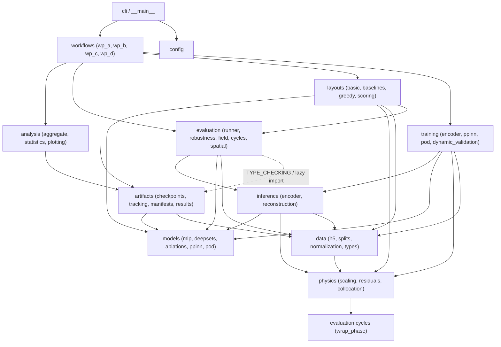

# Architecture & Module Dependencies

This document describes the package layout, module responsibilities, dependency direction, path-resolution priority, and scientific boundary guards in `cylinder_flow`.

---

## 1. Layered Package Overview

The codebase is organized under `src/cylinder_flow/` into clean, single-responsibility layers:

| Layer | Package / Module | Core Responsibilities |
| :--- | :--- | :--- |
| **Configuration** | `cylinder_flow.config` | `PathConfig`, `CheckpointPaths`, `get_path_config()` resolving data/processed/runs directories without hardcoded machine paths. |
| **Data & Splits** | `cylinder_flow.data` | HDF5 I/O (`h5.py`), normalization (`normalization.py`), Fluent preprocessing (`preprocessing.py`), dynamic sampling (`sampling.py`), Reynolds splits (`splits.py`), typed containers (`types.py`: `MeshData`, `ReCaseData`). |
| **Physics** | `cylinder_flow.physics` | Nondimensional scaling & Strouhal relation (`scaling.py`), Navier-Stokes PDE residuals (`residuals.py`), collocation sampling & Re-St contracts (`collocation.py`). |
| **Models** | `cylinder_flow.models` | Activation registry (`activations.py`), fixed-layout `SensorMLP` (`mlp.py`), permutation-invariant `DynamicSetSensorEncoder` / `SetSensorEncoder` (`deepsets.py`), 8 architecture-ablation variants (`ablations.py`), parametric PINN `PPINNModel` (`ppinn.py`), and `SurfacePOD` (`pod.py`). |
| **Training** | `cylinder_flow.training` | Trainers for MLP & DeepSets encoders (`encoder.py`), dynamic multi-budget validation (`dynamic_validation.py`), parametric PINN training (`ppinn.py`), and POD fitting (`pod.py`). |
| **Inference** | `cylinder_flow.inference` | Encoder state inference (`encoder.py`: `predict_re_case`, `predict_re_phase`) and full-field reconstruction (`reconstruction.py`: `reconstruct_field_oracle`, `reconstruct_field_closed_loop`, `reconstruct_case_oracle`, `reconstruct_case_closed_loop`). |
| **Sensor Layouts** | `cylinder_flow.layouts` | Geometry & random layouts (`basic.py`: `uniform_layout`, `physics_layout`, `sample_random_layouts`), POD/LinReg baselines (`baselines.py`), greedy & amortized-chain search (`greedy.py`), and proxy/FIM/excess scoring (`scoring.py`). |
| **Evaluation** | `cylinder_flow.evaluation` | Flow field & gauge-invariant pressure metrics (`field.py`), cycle segmentation (`cycles.py`), regression metrics (`regression.py`), spatial vorticity & mesh-local SSIM (`spatial.py`), noise & dropout perturbation (`robustness.py`), and unified evaluation runner (`runner.py`). |
| **Artifacts** | `cylinder_flow.artifacts` | Checkpoint loading/saving & Windows `PosixPath` compat (`checkpoints.py`), `run_meta.json` & deterministic seeding (`tracking.py`), canonical 23-field long-table I/O (`results.py`), and manifest/lock/test-gate validation (`manifests.py`). |
| **Analysis** | `cylinder_flow.analysis` | WP-A/B/C/D long-table aggregation & audit (`aggregate.py`), paired bootstrap / Wilcoxon / Holm-Bonferroni statistics (`statistics.py`), and headless plotting & table prep (`plotting.py`). |
| **Workflows** | `cylinder_flow.workflows` | Work Package orchestrators (`wp_a.py`, `wp_b.py`, `wp_c.py`, `wp_d.py`) enforcing protocol contracts, locked-test gates, and stage dispatch. |
| **CLI** | `cylinder_flow.cli` / `__main__` | Unified CLI entry point (`python -m cylinder_flow <subcommand>`) and PowerShell thin wrappers under `scripts/windows/`. |

---

## 2. Dependency Direction

Dependencies flow strictly downward from orchestration (`cli`, `workflows`) through high-level analysis/evaluation/training down to core data, physics, and model primitives:

> [!NOTE]
> `evaluation/runner.py` uses `if TYPE_CHECKING:` and function-local lazy imports when referencing `artifacts.checkpoints` (`LegacyPPINNPackage`, `LegacyMLPPackage`, `DeepSetsPackage`, `AblationPackage`) or `artifacts.results.build_long_rows` to avoid circular initialization between `artifacts -> data -> physics -> evaluation -> artifacts`.

---

## 3. Path Resolution Priority

All repository code resolves filesystem locations through `cylinder_flow.config.get_path_config(...)` (`src/cylinder_flow/config.py`) rather than hardcoding drive-specific paths. Resolution follows a strict four-level precedence order (highest to lowest):

1. **Explicit CLI / Function Arguments**: `data_dir`, `processed_dir`, `runs_dir`, and `config_path` passed directly to `get_path_config(...)` or workflow config loaders (e.g., `load_wp_a_config`).
2. **Environment Variables**: `CYLINDER_DATA_ROOT`, `CYLINDER_PROCESSED_DIR`, `CYLINDER_RUNS_DIR`, and `CYLINDER_CONFIG_PATH`.
3. **Repository Configuration File**: `configs/paths.json` (git-ignored local override created from `configs/paths.example.json`).
4. **Portable Fallback Defaults**: `./data`, `./data/processed_data_base_60`, and `./runs` relative to the repository root.

---

## 4. Scientific & Integrity Boundaries

Architectural boundaries enforce the scientific rules defined across the pipeline:

- **Disjoint Re Splits (`data.splits.ReSplit`)**: `train_re`, `val_re`, and `test_re` are validated at construction time (`validate_disjoint(strict=True)`). Default held-out test numbers are `{250, 650}`; validation numbers are `{450, 800}` (or fold-specific `loo_450` / `loo_800` in `configs/folds.json`).
- **Locked Test Gate (`artifacts.manifests.validate_re_split_locked_test_gate` & `evaluation.runner.enforce_locked_test_re_guard`)**: Access to locked test cases (`Re250.h5`, `Re650.h5`) raises `PermissionError` unless `allow_test=True` is explicitly provided alongside an approved, placeholder-free analysis lock (`approval_status == "approved"`, `example_not_formal == False`) when gated.
- **Train-Only Provenance**: Channel normalization statistics, noise-scale artifacts (`evaluation.robustness.build_noise_scale_from_cases`), and mesh-local SSIM scale artifacts (`evaluation.spatial.build_scale_artifact_from_fields`) forbid test Re leakage.
- **Deterministic Paired Seeding (`artifacts.tracking`)**:
  - `paired_train_seed(base_seed, nsensor, train_repeat_id) = base_seed + 700000 + nsensor * 1000 + train_repeat_id`
  - `random_layout_selection_seed(base_seed) = base_seed + 3000`
  - `random_layout_train_seed(base_seed, nsensor, layout_repeat_id, train_repeat_id) = paired_train_seed(base_seed, nsensor, train_repeat_id) + layout_repeat_id * 100000`
  - `chain_greedy_step_seed(base_seed, step) = base_seed + 500000 + step`
- **Unified Results & Audit Contract (`artifacts.results` & `analysis.aggregate`)**: Evaluators emit rows conforming to the 23-column `LONG_TABLE_FIELDS` schema (`metrics_long.csv`), which `aggregate_results` / `aggregate_wp_{b,c,d}_results` deduplicate and validate via `AuditLog` before statistical comparison and plotting.
